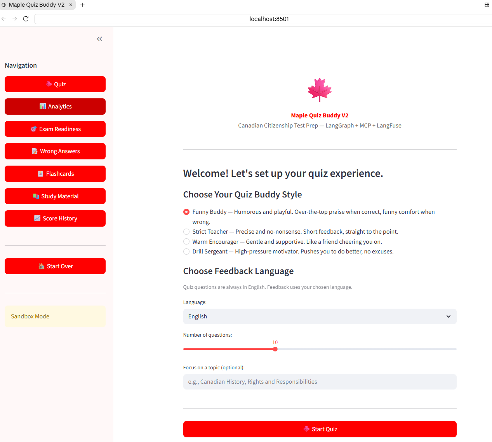
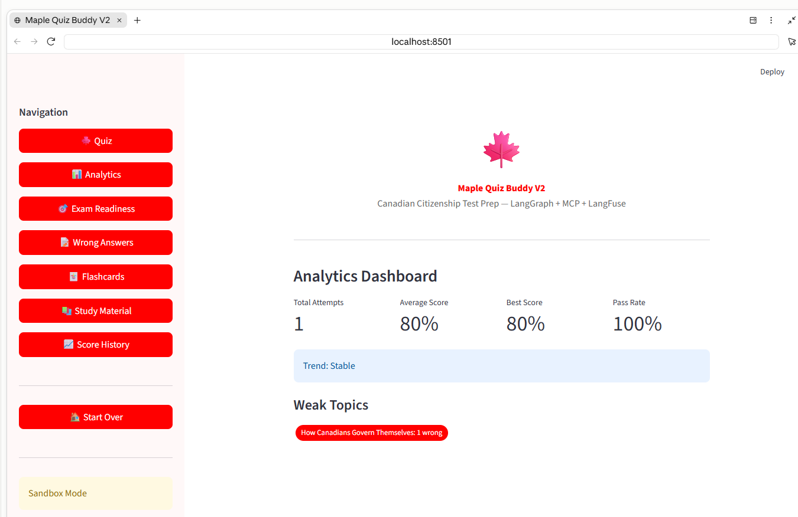

# Maple Quiz Buddy V2

Canadian Citizenship Test Prep powered by **LangGraph + MCP + LangFuse + xAI Grok**.





## Features

- **LangGraph State Machine** -- quiz flow as a directed graph (onboard -> generate -> quiz -> grade -> review)
- **MCP Server** -- 15 tools, 5 resources, 3 prompts; compatible with Claude Desktop & Claude Code
- **LangFuse Observability** -- trace every LLM call, track latency & token usage
- **xAI Grok LLM** -- powered by Grok via `langchain-xai`
- **RAG Retrieval** -- ChromaDB vector store over Discover Canada study guide
- **4 Personality Styles** -- Funny Buddy, Strict Teacher, Warm Encourager, Drill Sergeant
- **Multi-language Feedback** -- English, French, Chinese, Spanish, or any custom language
- **Streamlit Web UI** -- full browser-based experience with analytics dashboard

## Web App Pages

| Page | Description |
|------|-------------|
| Onboarding | Pick style, language, topic, question count |
| Quiz | Question-by-question with instant feedback |
| Results | Score card, pass/fail, review option |
| Review | Re-attempt wrong answers with hints |
| Analytics | Trends, weak topics, attempt comparison |
| Exam Readiness | Confidence prediction with stats |
| Wrong Answers | Filter by topic, view source text |
| Flashcards | Flip cards generated from mistakes |
| Study Material | RAG search across Discover Canada |
| Score History | Full attempt log with trend chart |

## Quick Start

```bash
# 1. Clone the repo
git clone https://github.com/YOUR_USERNAME/Maple_Quiz_Buddy_V2.git
cd Maple_Quiz_Buddy_V2

# 2. Install dependencies
pip install -r requirements.txt

# 3. Set up API keys (edit .env with your real keys)
cp .env.example .env

# 4. Run the web app
streamlit run web_app.py

# Or run CLI mode
python app.py

# Or run sandbox test
python app.py --test
```

## MCP Server (Claude Desktop)

Add to your Claude Desktop config (`claude_desktop_config.json`):

```json
{
  "mcpServers": {
    "maple-quiz-buddy-v2": {
      "command": "python",
      "args": ["path/to/mcp_server/server.py"],
      "env": {
        "XAI_API_KEY": "your-xai-api-key"
      }
    }
  }
}
```

## Project Structure

```
Maple_Quiz_Buddy_V2/
├── app.py                    # CLI entry point
├── web_app.py                # Streamlit web frontend
├── config.py                 # Global configuration
├── personality/
│   ├── style_selector.py     # 4 quiz buddy styles
│   └── buddy_prompts.py     # Dynamic prompt generation
├── rag/
│   ├── pdf_loader.py         # PDF chunk loader
│   └── vector_store.py       # ChromaDB vector store
├── quiz/
│   ├── question_generator.py # Quiz question generation
│   ├── grader.py             # Answer grading + wrong answer tracking
│   └── review_manager.py     # Wrong answer review sessions
├── memory/
│   └── score_tracker.py      # Score history + analytics
├── graph/
│   └── quiz_graph.py         # LangGraph state machine
├── observability/
│   └── tracing.py            # LangFuse integration
├── mcp_server/
│   └── server.py             # MCP server (15 tools, 5 resources, 3 prompts)
└── docs/
    ├── MCP_Deep_Dive.md      # MCP protocol educational guide
    └── screenshots/          # App screenshots
```

## Tech Stack

- **LLM**: xAI Grok (via `langchain-xai`)
- **Framework**: LangChain + LangGraph
- **Vector Store**: ChromaDB
- **Observability**: LangFuse
- **Protocol**: MCP (Model Context Protocol)
- **Web UI**: Streamlit
- **Language**: Python 3.10+

## Sandbox Mode

Runs with mock data when API keys start with `TEST_` -- no real API calls needed for development and testing.

## License

MIT
